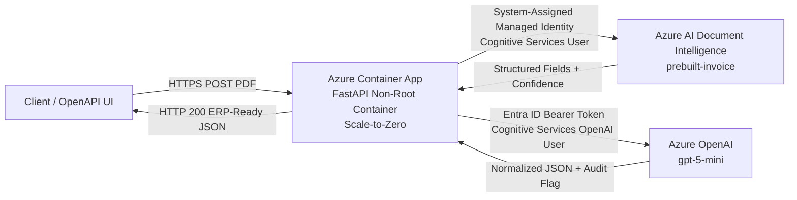

# Azure GenAI Intelligent Document Processing (IDP) Platform

A serverless **Intelligent Document Processing (IDP) & GenAI Auditing** microservice built on **Azure AI Document Intelligence**, **Azure OpenAI (`gpt-5-mini`)**, and **Azure Container Apps**, architected for **zero stored API keys** and **scale-to-zero FinOps efficiency**.

## Architecture

## Core Platform Capabilities

- **Zero-Key Security:** Authenticates end-to-end with `DefaultAzureCredential` and least-privilege Data-Plane RBAC — zero API keys in container images or runtime environment variables.
- **Confidence-Gated Auditing:** Normalizes dates (YYYY-MM-DD) and numeric amounts, verifies `SubTotal + TotalTax == InvoiceTotal`, and flags low-confidence extractions (< 0.85) for manual review.
- **Infrastructure as Code:** Modular Terraform (`infra/terraform/`) covering AI resources, model deployment, Container Apps environment, and RBAC role assignments.

See [docs/architecture-decisions.md](docs/architecture-decisions.md) for detailed design rationales.
